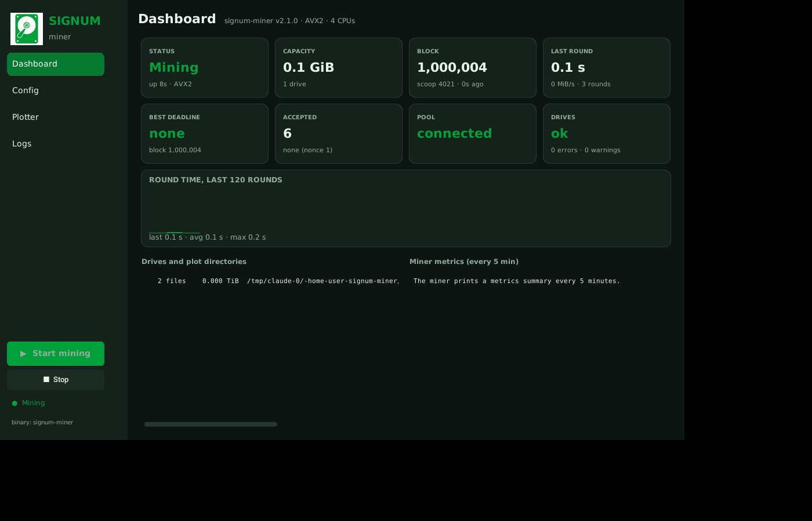
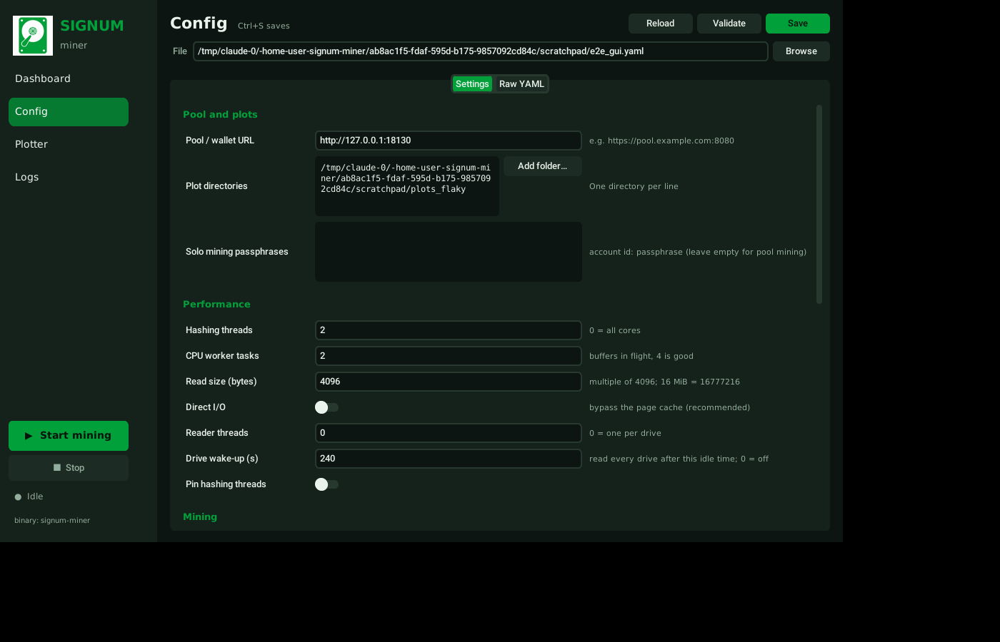
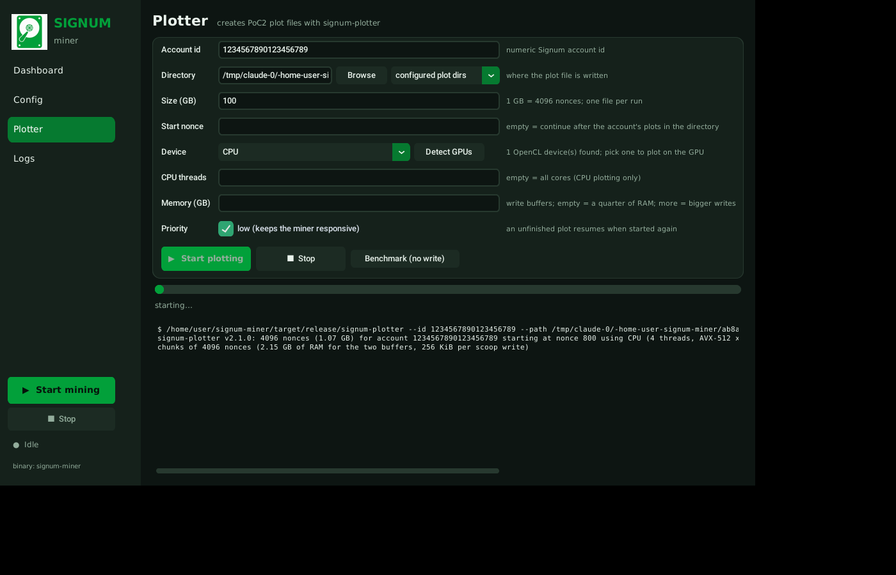

# Signum Miner

[](https://github.com/signum-network/signum-miner/actions)
[](./LICENSE)
[](https://t.me/signumnetwork)
[](https://discord.gg/9rH2bbCNpe) 
</br>
[](https://signum.network)
[](https://docs.signum.network/signum/starting-mining-signa)

---

## ⚡ **Why Signum Miner?**

Signum is the world's first truly sustainable blockchain — and the Signum Miner is your gateway to mining it efficiently and eco-consciously. Whether you're using modern AVX512-capable CPUs, an ARM board, or legacy hardware, the Signum Miner is optimized to deliver fast results with minimal energy.

> Join the green revolution of decentralized computing — mine with purpose. Mine with Signum.

---

## 🔧 **Features**

- Ultra-low energy-power mining algorithm (**Proof of Commitment (PoC+)**)
- AVX512, AVX2, AVX, SSE2 and NEON **SIMD optimizations**
- Multi-threaded & high performance I/O
- Integrated plot reader, CPU miner & buffer pipeline
- Full async + **Tokio** + **crossbeam** architecture
- Built-in **PoC2 plotter** (`signum-plotter`) for the CPU or, with the `opencl` feature, a GPU
- Desktop **GUI** in Signum colours: dashboard, config editor, plotter and logs

## 🧰 **Feature Overview**

| Architecture     | Feature(s)               | Description                            |
|------------------|--------------------------|----------------------------------------|
| x86 (Intel/AMD)  | sse2, avx, avx2, avx512f | SIMD extensions for Desktop/Server CPUs |
| ARM (e.g. Pi)    | neon                    | SIMD for ARM CPUs                      |


| Variant  | Description                                              | CPU Availability                            |
|----------|----------------------------------------------------------|---------------------------------------------|
| sse2     | Older, widely supported SIMD extension                   | Almost all x86 CPUs since 2001              |
| avx      | Advanced Vector Extensions – larger 256-bit registers    | Intel: Sandy Bridge (2011), AMD: Bulldozer  |
| avx2     | Improved AVX version with integer support                | Intel: Haswell (2013), AMD: Excavator       |
| avx512f  | Even wider 512-bit SIMD registers – very powerful        | Intel: Skylake-X (rare in consumer CPUs)    |
| neon     | SIMD extension for ARM architecture                      | ARMv7 (32-bit) and ARMv8 (64-bit, e.g. Raspberry Pi 4) |

---


## 📦 **Installation**

### 🖥️ Precompiled Binaries

➡️ [Go to Releases](https://github.com/signum-network/signum-miner/releases)

Download the binary matching your system:

For Linux distributions:
- `signum-miner-avx`
- `signum-miner-avx2`
- `signum-miner-avx512f` (modern CPUs)
- `signum-miner-sse2` (legacy CPUs)
- `signum-miner-aarch64-neon` (ARM 64-bit: Raspberry Pi 4/5, most SBCs)

For Windows distributions one of the `.exe` versions:
- `signum-miner-avx`
- `signum-miner-avx2`
- `signum-miner-avx512f` (modern CPUs)
- `signum-miner-sse2` (legacy CPUs)

The miner checks at start-up that the CPU supports the SIMD instructions it
was built with and refuses to run otherwise, instead of crashing with an
"Illegal instruction" halfway through the first round.

## ⚙️ **Running the binaries**

### Config

The miner needs a **config.yaml** file; start from the one in this repository
or in the release. A minimal config is just:

```yaml
plot_dirs:
  - '/mnt/bay1/plots'
  - '/mnt/bay2/plots'
url: 'https://pool.example.com:8080'
```

Every other setting has a working default and is documented in
[`config.yaml`](./config.yaml). Unknown keys are reported as warnings at
start-up so typos do not silently fall back to defaults. Run
`./signum-miner --check` to validate the configuration and scan the plot
directories without starting to mine.

Settings worth knowing:

- `hdd_use_direct_io` (default `true`): reads bypass the page cache, which keeps
  memory free and CPU usage low. Plots on filesystems that do not support it
  (for example NTFS via `ntfs-3g`) automatically fall back to buffered reads;
  you will see a warning per plot file.
- `io_buffer_size` (default 16 MiB): bytes per read request. 8–32 MiB works well
  for USB and SATA drives; it must be a multiple of 4096.
- `hdd_wakeup_after` (default 240 s): when no new block has arrived for this
  long the miner reads one block from every drive so external enclosures do not
  spin down. Set to `0` to disable.
- `capacity_check_interval` (default 6 h): how often plot directories are
  rescanned. While a directory is missing, empty or returned errors the miner
  rescans every minute instead, so a bay that is mounted late or re-plugged is
  picked up quickly without a restart.
- `plot_missing_grace` (default 1 h): a plot file that a rescan cannot find
  (USB reset, bay unplugged, mount not back yet) keeps its place in the
  capacity and is retried every round for this long before it is dropped, so
  the reported capacity does not jump around with every hiccup.
- `submit_only_best` (default `true`): submit the best deadline once the round
  is complete rather than every improvement as it is found. If the next block
  arrives before the round is complete, the best deadline found so far is
  submitted anyway.
- `early_submit_deadline` (default 600 s): with `submit_only_best`, a deadline
  this short (or shorter than about twice the previous round time) is sent the
  moment it is found, because waiting for the end of the round could let it
  expire. The best deadline is still sent at the end of the round.
- `show_progress`: the progress bar is only drawn on an interactive terminal; under
  systemd or with output redirected to a file it is switched off automatically.

### Running

Be sure to have the config file in the same folder as your binary, or pass
`--config /path/to/config.yaml`.

For Windows, double click on the executable file. If it refuses to run, start
the executable from a command prompt to check for error messages.

For Linux:
```shell
./signum-miner
```

The miner exits with a non-zero status on configuration errors and aborts on
internal errors, so a supervisor such as systemd can restart it.

### 🍓 Raspberry Pi 5 with external drive bays

This is a first-class target. A plain `cargo build --release` on the Pi picks
the NEON hashing backend automatically; no feature flags are needed.

```bash
sudo apt-get install -y build-essential git curl
curl https://sh.rustup.rs -sSf | sh -s -- -y && source "$HOME/.cargo/env"
git clone https://github.com/signum-network/signum-miner
cd signum-miner
cargo build --release
./target/release/signum-miner --config config.yaml --check
```

Recommended settings for a Pi 5 (4 cores) feeding several USB 3 bays:

```yaml
plot_dirs:
  - '/mnt/bay1/plots'
  - '/mnt/bay2/plots'
  - '/mnt/bay3/plots'
  - '/mnt/bay4/plots'
url: 'https://pool.example.com:8080'
cpu_threads: 0              # all 4 cores hash
cpu_worker_task_count: 4
io_buffer_size: 16777216    # 16 MiB per read keeps USB queues full
hdd_use_direct_io: true     # no page-cache churn on 4-8 GB of RAM
hdd_wakeup_after: 120       # keep the bays spinning between blocks
show_progress: false        # headless
logfile_log_level: off      # journald captures stdout
```

Notes:

- One reader thread is created per physical drive (the miner groups plots by
  the device they live on), so each bay streams independently.
- Format drives as ext4 or exFAT. NTFS via `ntfs-3g` works but only with
  buffered reads, which the miner falls back to automatically.
- Mount the bays through `/etc/fstab` with stable identifiers (`UUID=` or
  `LABEL=`) so `/mnt/bayN` always points at the same disk, and add
  `nofail,x-systemd.automount` to the options so a bay that resets or is
  re-plugged is mounted again the next time the miner touches it, without a
  reboot or a restart:
  `UUID=... /mnt/bay1 ext4 defaults,noatime,nofail,x-systemd.automount 0 2`.
  The included [`contrib/signum-miner.service`](./contrib/signum-miner.service)
  shows how to make systemd wait for those mounts and restart the miner if it
  ever stops.
- Many enclosures have their own idle spin-down timer; `hdd_wakeup_after`
  issues a real read (not just a seek) so they stay awake. If an enclosure still
  sleeps, lower the value or disable its timer with `hdparm -B 255` /
  `sdparm --clear STANDBY`.
- Run `./signum-miner --check` after plugging a new bay: it lists every plot
  directory with the bus it is attached to (USB, SATA, NVMe) and the capacity.

### Why does the pool show less capacity than I have?

Pools do not know your plot size; they *estimate* capacity from the quality
of the deadlines you submit over the last few hundred blocks. Every block
without a submission, and every block where only part of the farm was
scanned, lowers that estimate. The things that cause it, in order of
likelihood:

1. **Rounds taking longer than a block (about 240 s).** Watch the
   `round finished: roundtime=…` line and the warning the miner prints when
   a round exceeds 180 s. 97 TB means ~24 GB to read and hash per block; a
   Pi 5 hashes a few hundred MB/s with NEON, so the round should finish in
   one to two minutes. If it does not, find the bottleneck with
   `benchmark_only: 'XPU'` (hashing only, no disk reads) and
   `benchmark_only: 'I/O'` (disk reads only, no hashing) and compare the
   reported speeds.
2. **Drives disappearing.** A USB reset or a late mount used to drop the
   bay from the scan; now it stays in the capacity for `plot_missing_grace`
   and is retried every round. The 5-minute disk health report shows which
   drive is producing read errors, how long each drive took for its last
   round and which one was slowest: the round cannot finish before the
   slowest bay does, so that is the one to look at.
4. **Good deadlines arriving late.** With `submit_only_best` the best
   deadline used to be sent only after the whole farm was scanned; a
   deadline shorter than the scan had already expired by then. Short
   deadlines are now sent immediately (`early_submit_deadline`).
3. **Plots skipped or rejected.** Fixed in 2.1.0 (wrong nonce for every
   scoop but 0, direct I/O alignment, rounds that never completed). A plot
   the miner cannot load is logged at start-up with the reason.

### Running as a service (systemd)

```bash
sudo mkdir -p /opt/signum-miner
sudo cp target/release/signum-miner config.yaml /opt/signum-miner/
sudo useradd --system --home /opt/signum-miner --shell /usr/sbin/nologin signum
sudo chown -R signum:signum /opt/signum-miner
sudo cp contrib/signum-miner.service /etc/systemd/system/
sudo systemctl daemon-reload
sudo systemctl enable --now signum-miner
journalctl -u signum-miner -f
```

Every five minutes the miner logs a metrics summary (rounds, round time,
submissions, data read, network errors) and a per-drive health report
(read errors and consecutive failures), which is what to watch on a headless
box.

### GUI helper

`miner_ui.py` is a desktop control panel for the miner, in Signum colours:



- **Dashboard** – live status parsed from the miner output: block and scoop,
  round time and read speed, capacity and unreadable plots, best deadline of
  the current block, accepted submissions, pool state, the 5-minute metrics
  and disk health reports.
- **Config** – a settings editor grouped into pool/plots, performance, mining
  and logging. Saving keeps the comments and order of your `config.yaml`;
  *Validate* runs `signum-miner --check` on what is on screen before you
  save; the *Raw YAML* tab is there for anything unusual.
- **Plotter** – fills new drives from the GUI: account, directory (pick one
  of the configured plot directories or browse), size, CPU threads or an
  OpenCL GPU detected from `signum-plotter --list-devices`, with a progress
  bar, rate, ETA and a benchmark mode. The next free nonce is worked out from
  the plots already in the directory, so plots never overlap.
- **Logs** – the miner output with level colouring and a level filter.

The dashboard keeps a chart of the last 120 round times, lists every drive
with its file count, size, bus type and health (error rate, last round time
and speed from the miner's disk health report), and the window remembers
its size, page, config file and plotter settings between runs
(`~/.config/signum-miner/ui.json`). `Ctrl+S` saves the config.

```bash
pip install -r requirements.txt
python3 miner_ui.py                      # opens config.yaml next to the script
python3 miner_ui.py --config /opt/signum-miner/config.yaml
```

The UI looks for the `signum-miner` binary next to `miner_ui.py`, then in
`target/release` and `target/debug`, then on `PATH`. It needs Python 3.9+
with Tk (`sudo apt-get install python3-tk` on Debian/Raspberry Pi OS).





### Plotting (signum-plotter)

`cargo build --release` also builds `signum-plotter`, which writes PoC2 plot
files in the `<account>_<start nonce>_<nonces>` format the miner reads. The
output is verified byte for byte against an independent reference generator
in the test suite, for every CPU instruction set and the GPU path.

It is built for speed. On the CPU, 16 (AVX-512), 8 (AVX2) or 4 (SSE2, AVX,
NEON) nonces are hashed at once with the same parallel Shabal code the miner
uses, on all cores; an x86 build picks the widest instruction set the CPU
has at run time. The GPU kernel keeps its work buffer interleaved by nonce so
every memory access of a wavefront is coalesced, which is what separates a
memory-bound from a compute-bound plotter. Generation and writing overlap,
and each scoop is written in one large piece per chunk (256 KiB with the
default buffers), so a hard drive runs near its sequential speed.

Measured on a 4-core Xeon @ 2.8 GHz (nonces per minute, 1 nonce = 256 KiB):

| Generator                       | 4 threads | 1 thread |
|---------------------------------|----------:|---------:|
| previous scalar code            |     3 500 |      900 |
| AVX2, 8 lanes                   |    17 000 |    4 600 |
| AVX-512, 16 lanes               |    37 700 |   11 800 |

37 700 nonces/min is 165 MB/s, more than a USB 3 hard drive writes. A GPU
has not been measured here (only the pocl CPU emulation, where the new kernel
is 1.6x the old one); on a real GPU the drive will be the limit.

```bash
# 4 TB plot (1 GB = 4096 nonces), continuing after this account's existing
# plots in the directory, on all CPU cores
signum-plotter --id 10282355196851764065 --path /mnt/bay1/plots --size-gb 4000

# Pick the start nonce and nonce count yourself, 4 threads
signum-plotter -i 10282355196851764065 -p /mnt/bay1/plots -s 0 -n 16777216 -t 4

# GPU plotting needs a build with OpenCL support
cargo build --release --features opencl
signum-plotter --list-devices                   # 0:0  NVIDIA CUDA / GeForce ... (46 compute units, 8.0 GiB)
signum-plotter -i 10282355196851764065 -p /mnt/bay1/plots --size-gb 4000 --gpu 0:0

# How fast is this machine? Generates without writing anything.
signum-plotter -i 1 -p . --nonces 65536 --bench --gpu 0:0

# Bigger write buffers (8 GB of RAM instead of a quarter of the machine's):
# every scoop is written in 1 MiB pieces, the best case for hard drives
signum-plotter -i 10282355196851764065 -p /mnt/bay1/plots --size-gb 4000 --mem 8

# Fill the rest of the drive, at low priority while the miner keeps running
signum-plotter -i 10282355196851764065 -p /mnt/bay1/plots --fill --low-priority

# Interrupted (Ctrl-C, power cut)?  Run the same command again: it continues
# from where it stopped.  Works for plots started by the official
# signum-plotter / engraver too, and the other way round.
signum-plotter -i 10282355196851764065 -p /mnt/bay1/plots --size-gb 4000
```

Notes:

- One file per run. The plotter really preallocates the file (`fallocate`,
  so it is not fragmented by the 4096 interleaved write streams) and writes
  it scoop by scoop (no re-sorting pass). Check free space first: 256 KiB
  per nonce, or use `--fill`.
- **Resumable.** Like the official plotter, the last 8 bytes of the file
  hold the number of nonces written so far (updated after every chunk). An
  interrupted run continues when started again with the same account, start
  nonce and size, whichever plotter wrote it. The miner reads the same
  marker: an unfinished plot is mined up to the written part with a warning
  instead of submitting garbage deadlines for the empty rest, so a plot in
  progress can sit in the plot directory.
- **Direct I/O.** Data is written with `O_DIRECT` on Linux, so a terabyte
  plot does not go through the page cache and push everything else out
  (`--no-direct-io` to write buffered; filesystems that refuse `O_DIRECT`
  fall back automatically). This needs 4 KiB aligned writes, so nonce
  counts are rounded down to a multiple of 64 unless `--exact`; the miner
  likes that too, because every scoop region then starts on a 4 KiB
  boundary and its own direct I/O reads need no alignment skip.
- `--low-priority` runs the hashing threads niced so a miner on the same
  machine keeps its cores (the GUI's Plotter page has this on by default).
- `--mem` is the RAM for the two write buffers (default: a quarter of the
  machine's RAM, at most 4 GB). Each scoop is written in one piece per
  buffer, so 2 GB buffers mean 256 KiB writes and 8 GB mean 1 MiB writes.
  On a hard drive bigger is faster; on the Pi 5 (8 GB) the default is fine.
- `--batch` (GPU only) is the number of nonces per kernel launch, by default
  sized to half of the device memory (512 KiB per nonce in flight).
- Compared with the official `signum-plotter`: same file format, naming and
  resume marker (its output was compared byte for byte with ours), same
  direct and double-buffered I/O, memory, thread and priority options, CPU
  SIMD and OpenCL support. Not implemented: plotting on several GPUs at
  once, zero-copy buffers for integrated GPUs.
- A GPU is only faster when the drive can keep up: a USB 3 bay writes at
  100–200 MB/s, i.e. 25–45k nonces/min, which an AVX-512 CPU or any modern
  GPU already exceeds. The `done:` line reports the achieved MB/s.
- The Raspberry Pi 5's VideoCore GPU has no OpenCL driver, so on the Pi the
  plotter uses the four CPU cores with NEON. For large farms plot on a PC
  and move the drives, or let the Pi plot in the background while it mines
  (`--threads 2` leaves cores for the miner).
- Plots made by other PoC2 plotters (the Signum `plotter` / `engraver`)
  are compatible either way.

---

## 💻 Build from Source
 - First you need to install a Rust stable toolchain (1.80 or newer), check https://www.rust-lang.org/tools/install.
 - A C compiler is needed for the Shabal hashing code (`build-essential` on Debian/Ubuntu/Raspberry Pi OS).
 - Binaries are in **target/debug** or **target/release** depending on optimization.

```bash
# Install Rust
curl https://sh.rustup.rs -sSf | sh

# Clone the repository
git clone https://github.com/signum-network/signum-miner
cd signum-miner
# Or run the automated setup which installs requirements and builds
python3 setup.py

# Default build: AVX2 on x86-64, NEON on aarch64 (Raspberry Pi), portable
# Rust elsewhere. The build script picks the backend that matches the target.
cargo build --release

# Pick a different x86 backend (choose exactly one)
cargo build --release --no-default-features --features simd_sse2
cargo build --release --no-default-features --features simd_avx
cargo build --release --no-default-features --features simd_avx512f

# Portable build without SIMD (slow, for unusual CPUs)
cargo build --release --no-default-features

# OpenCL GPU support for the miner and the plotter (needs an OpenCL SDK /
# ICD loader, e.g. ocl-icd-opencl-dev on Debian)
cargo build --release --features opencl

# Cross-compile for a Raspberry Pi from an x86-64 Linux box
rustup target add aarch64-unknown-linux-gnu
sudo apt-get install -y gcc-aarch64-linux-gnu
CARGO_TARGET_AARCH64_UNKNOWN_LINUX_GNU_LINKER=aarch64-linux-gnu-gcc \
  cargo build --release --target aarch64-unknown-linux-gnu
```

The `async_io` feature of earlier versions is deprecated and has no effect;
plot reads always use positional blocking I/O on dedicated reader threads.

### Tests

```bash
cargo test --release
```

The test suite includes an independent PoC2 plot generator and deadline
oracle (built on the reference C Shabal implementation) that verifies the
miner maps every byte on disk to the right nonce and that the compiled SIMD
backend agrees with the reference on real plot data. The same oracle checks
`signum-plotter`: the pipeline test writes a plot and compares it with the
reference plot in `test_data`, and with `--features opencl` the GPU kernel is
compared nonce by nonce with the CPU generator on whatever OpenCL device is
present (CI uses the `pocl` CPU runtime). CI runs it for AVX2, SSE2, the
portable backend, the OpenCL build and, under QEMU, for the aarch64 NEON
build.

## 📜 License

This project is licensed under the GPLv3 — see the LICENSE file for details.</br>
Made with ❤️ for the future of decentralized sustainability — Signum.

### Forked from
This is a code fork from https://github.com/PoC-Consortium/scavenger